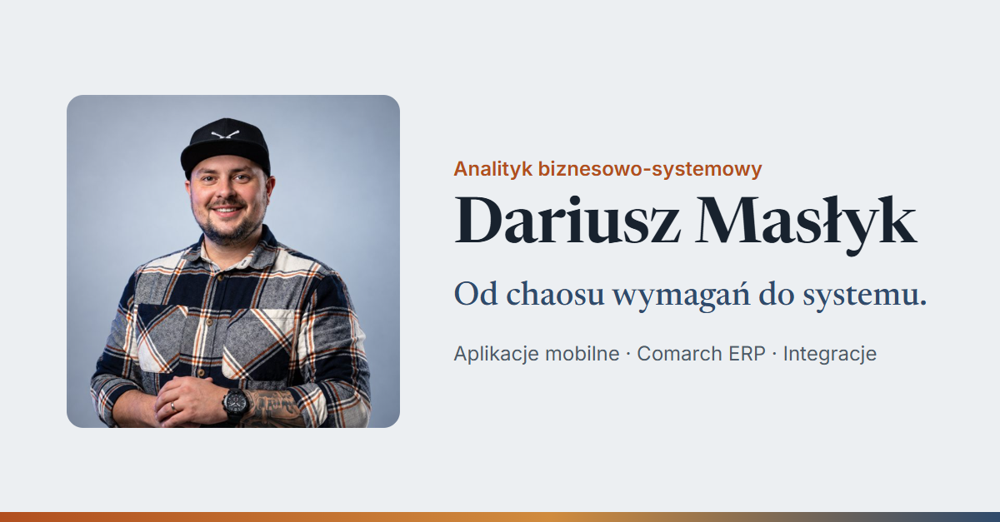

# Dariusz Masłyk — portfolio analityka biznesowo-systemowego

### 👉 [Otwórz stronę: backloghero-lang.github.io/dariusz-maslyk](https://backloghero-lang.github.io/dariusz-maslyk/)

Interaktywne portfolio pokazujące, jak pracuję jako analityk biznesowo-systemowy w Comarch Mobile: od zebrania wymagań, przez koncepcję i UI/UX aplikacji mobilnej, po integrację z Comarch ERP, testy i diagnostykę.

## Co jest na stronie

- **Jak pracuję** — pięć etapów pracy analityka, prowadzonych przez scenę 3D, która zmienia się podczas przewijania.
- **Mapa kompetencji** — skąd biorą się moje kompetencje: doświadczenie z Comarch i firm handlowych (ALDI, Auchan, Komfort, GK SPECJAŁ) → kompetencje → projekty i obszary odpowiedzialności.
- **Wybrane projekty** — cztery inicjatywy z Comarch Mobile: promocje pakietowe, Asystent zamówień AI, przepływ dokumentów oferta → zamówienie → faktura oraz telemetria aplikacji. Karty w teczkach pokazują typowe artefakty analityka (user story, tablice decyzyjne, makiety, model danych, scenariusze testów). To ilustracje, nie poufna dokumentacja.
- **Kariera** — linia czasu doświadczenia i certyfikatów.
- **Kontakt** i CV do pobrania.

## Technicznie

- Statyczna strona bez kroku budowania: HTML, CSS i moduły JavaScript.
- Scena 3D w [three.js](https://threejs.org/) z wersją statyczną dla słabszych urządzeń i dla osób z włączonym ograniczeniem animacji.
- Responsywna (telefon, tablet, komputer), z obsługą klawiatury i czytników ekranu.
- Hosting: GitHub Pages.

## Kontakt

[LinkedIn](https://www.linkedin.com/in/dariusz-maslyk/) · [CV (PDF)](https://backloghero-lang.github.io/dariusz-maslyk/assets/Dariusz_Maslyk_CV.pdf)
